# Open EEG headset frame (EEGF) v0.1.0

A 3D-printable headset frame that holds 16 EEG electrodes at 10-20 positions, in three sizes.
It is made for the 16 channels of an OpenBCI Cyton board with the Daisy module and for OpenBCI
5 mm dry comb electrodes. The board and a small LiPo cell go in a pod at the back. It is
our own design, made from scratch in [`design.py`](design.py).

Recording only. This is not a medical device. It does not diagnose or treat anything, and it has
no part for stimulation.

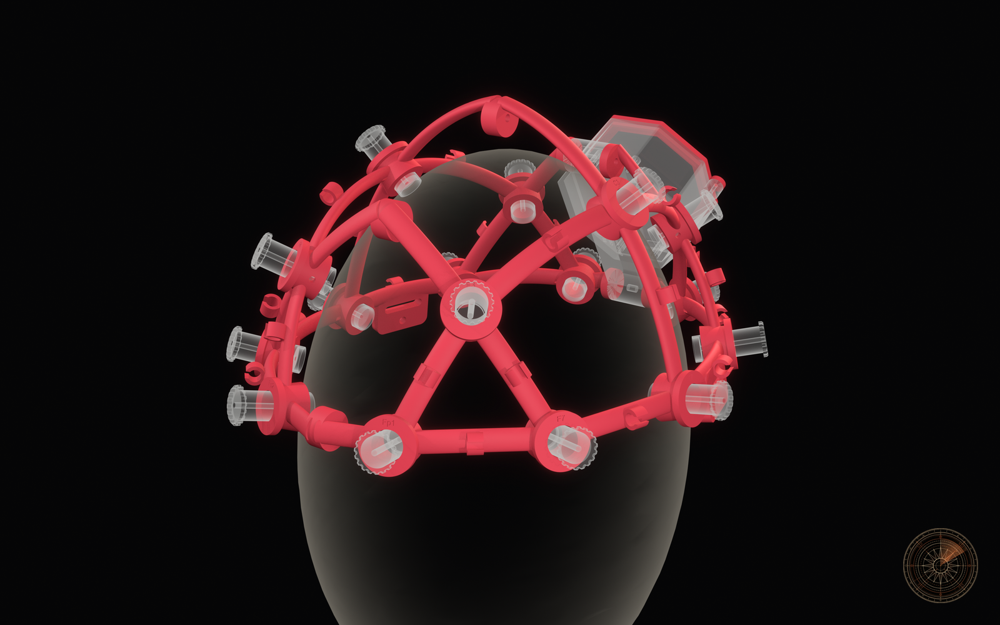

Build guide with the parts list and prices: https://theconsciousness.ai/hardware/designs/eeg-headset-frame/
See the signal live in the browser: [Open EEG Viewer](https://theconsciousness.ai/hardware/eeg-viewer/), source in [`software/eeg-viewer`](../../software/eeg-viewer/).

## Images

Renders, not photos. The glass shape is the ellipsoid head model used for the checks. The dark
octagon is a simplified model of the Cyton board, and the dark block under it is the battery.
The frame and the cover are red-pink (`#e64254`, the film key word colour). The pod and the 16 carriers are clear glass.

| | |
|---|---|
| 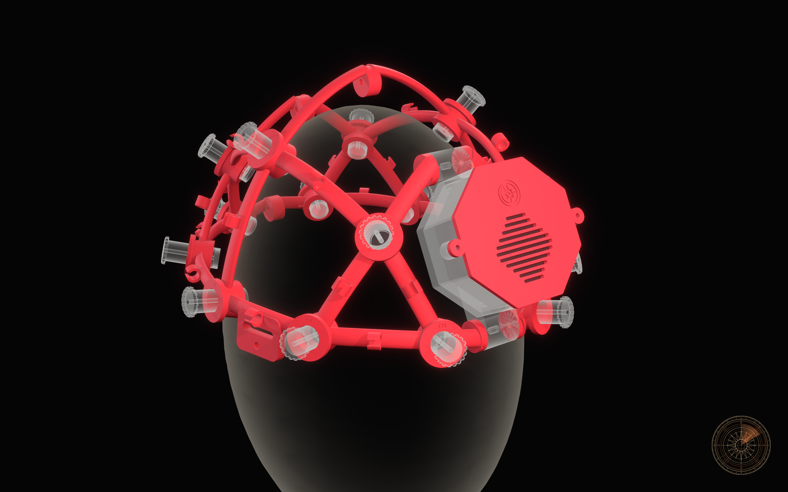 | 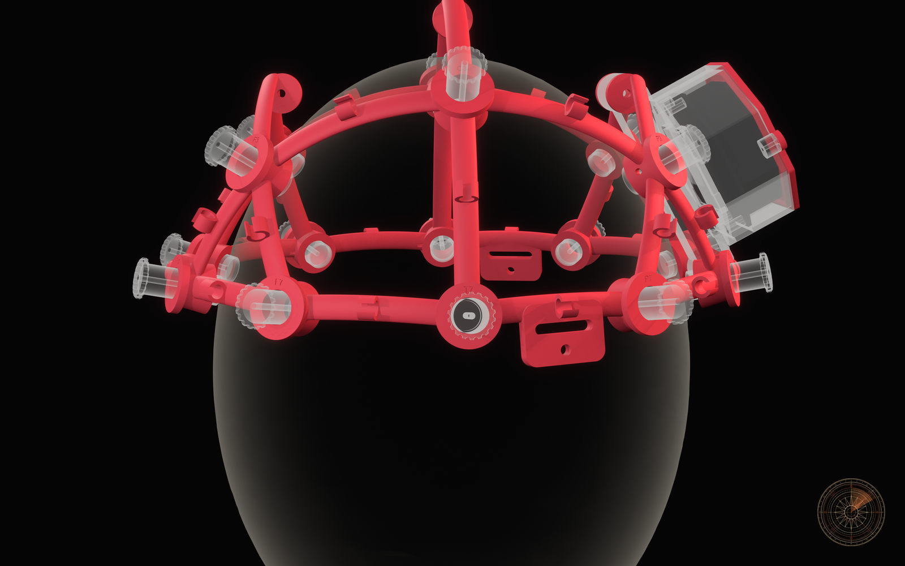 |
| From the back, with the clear pod, the board and the coral cover | From the side, with the strap tab behind the ear |
| 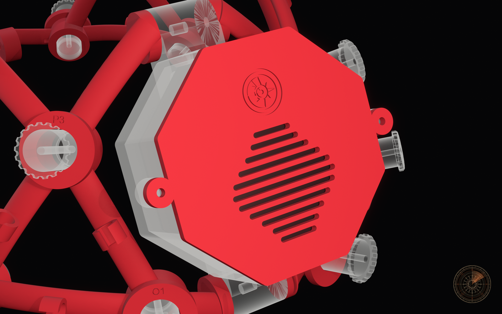 | 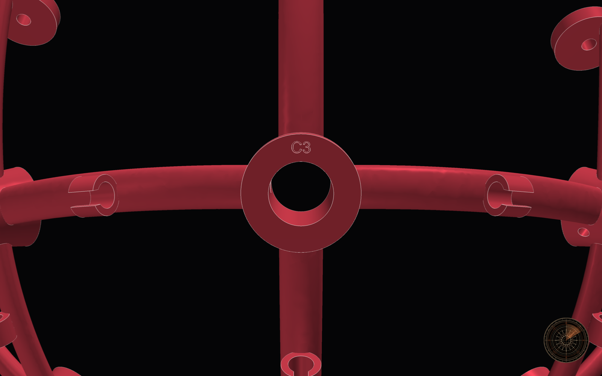 |
| Board pod with the vent cover and the compass mark (branded) | Each hub carries its 10-20 name |
| 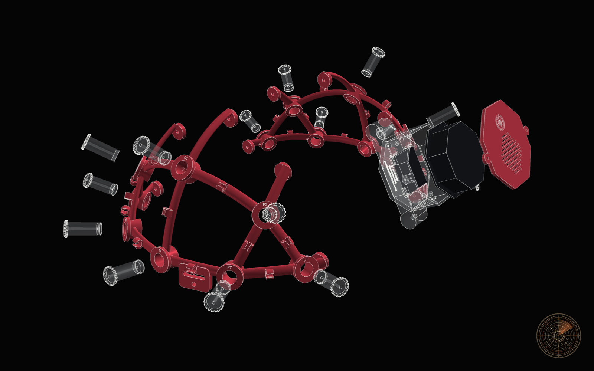 | 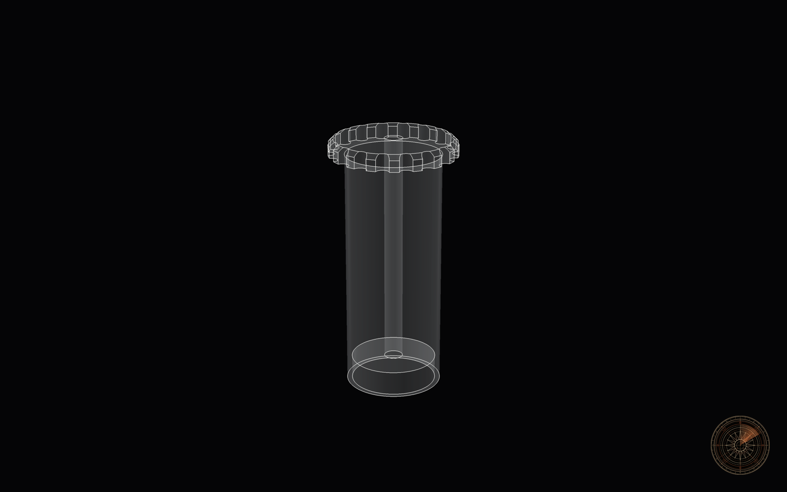 |
| Exploded view with the two halves, the spine with the pod, the battery, the board, the cover and 16 carriers | Electrode carrier with grip grooves. Print 16 |
| 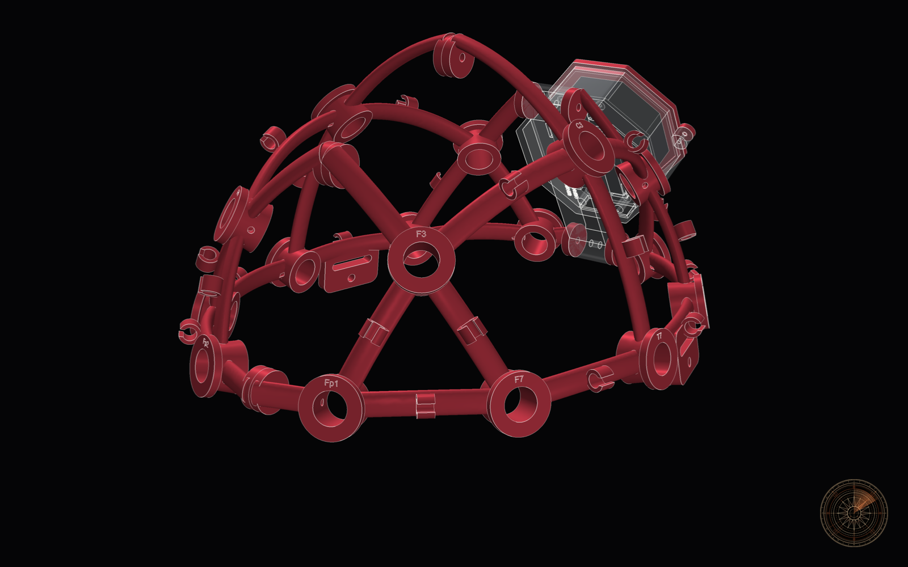 | 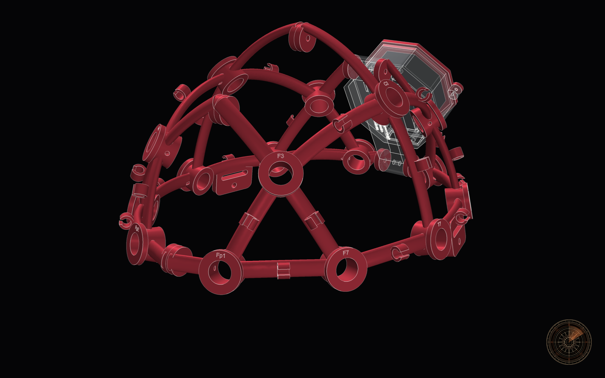 |
| CAD view, store variant | CAD view, branded variant |
| 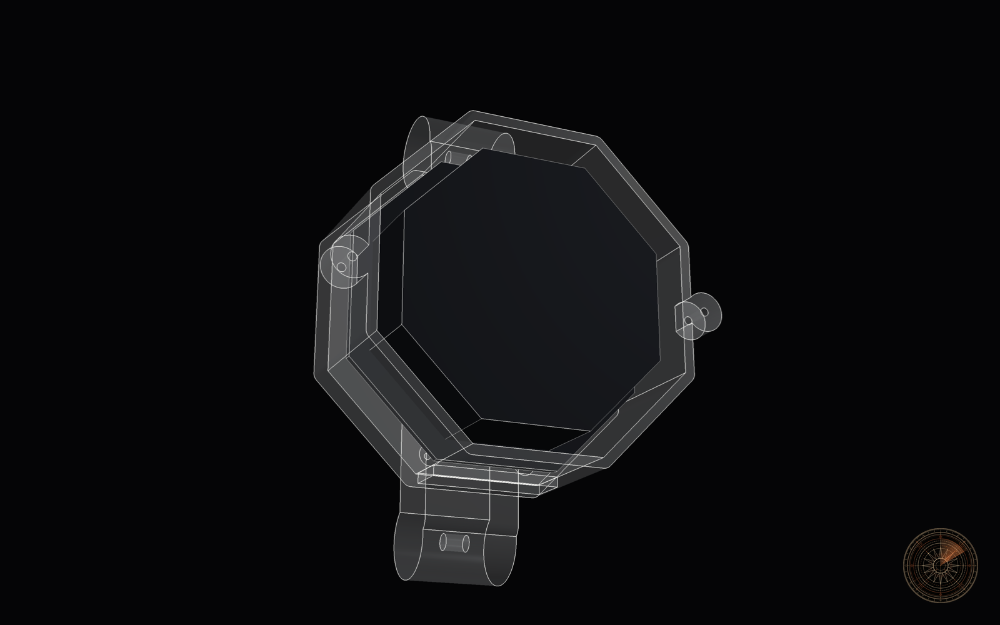 | 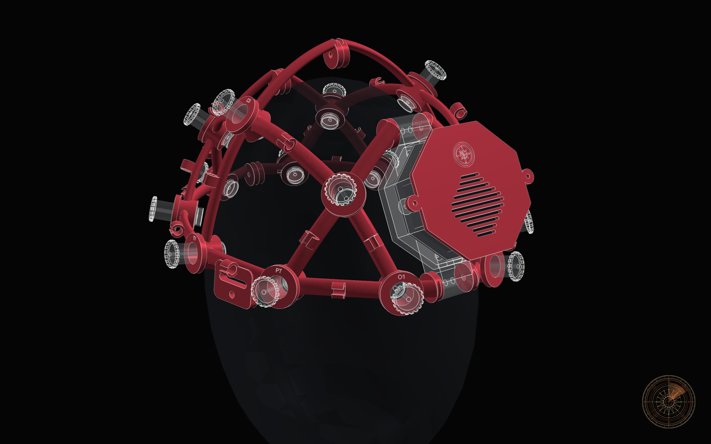 |
| Pod without the cover, with the board model | CAD view on the head model, branded variant |

The `hero-*` images are Blender renders made with the film look
(`tcai-video-engine/hardware-eeg/`). The other images come from `python render.py
eeg-headset-frame`. Copies without the logo, for print service listings, are in
[`renders/listing/`](renders/listing/).

## Test state

| Check | State |
|---|---|
| Parts overlap in CAD (left/right, halves/spine, spine/board, cover/spine, cover/board, battery/spine, battery/board) | Passed, 0.000 mm3, sizes S, M, L |
| Frame to scalp on the head model | Passed. Halves 7.0 mm, spine 3.8 mm or more (minimum 3 mm) |
| Carriers in the hubs at the contact position | Passed, 0.000 mm3 overlap, 14 mm of the carrier in the hub |
| Each part inside a 250 x 250 x 250 mm print volume | Passed. The L half is 248 mm long |
| Board posts | From the Cyton docs: "Mount holes are 1/16 ID, 0.8 x 2.166 on center" |
| Battery | The Cyton docs say "Power with 3-6V DC Battery ONLY". The bay takes a 1S LiPo pouch cell, 503035 type (5 x 30 x 35 mm, 3.7 V, about 500 mAh) with a protection circuit. An OpenBCI community post names "a recommended Lithium Polymer cell of about 500mAh" for the Ultracortex |
| Electrode | OpenBCI 5 mm dry comb electrode: "Top diameter 1/4", bottom diameter 13/32"". The carrier cup is 10.7 mm |
| Electrode screw | **Not verified.** OpenBCI does not publish the screw size. The Mark III docs list 2-56 screws. The carrier has a 2.3 mm hole that takes 2-56 or M2. Check with a real electrode |
| Daisy module | **Not modelled.** It stacks on the Cyton headers. No published drawing found. The pod keeps 18 mm above the board for it. **Estimate** |
| Head model | **An ellipsoid**, not a scan of a real head. Ears are not modelled. The strap tab and the lead hole sit above and behind the ear for this reason. The clearance of the T7 and T8 hubs to a real ear is **not checked** |
| Printed | **No** |
| Tried on a head | **No** |
| Signal recorded with this frame | **No** |

Do not order a print for a project that depends on it until the "Printed" and "Tried on a head"
rows say yes.

## How it is built

- **Head model.** An ellipsoid for each size. Width is 0.8 of length. Height above the reference
  plane (nasion, inion, preauricular points) is 1.33 of half length.

  | Size | Head circumference | Nasion-inion arc | Preauricular arc |
  |---|---|---|---|
  | S | 540 mm | 350 mm | 323 mm |
  | M | 570 mm | 370 mm | 341 mm |
  | L | 600 mm | 389 mm | 359 mm |

  Measure your head around the forehead and the back of the head and take the nearest size.
  Real heads are not ellipsoids. The arcs show how near the model is to a measured head.
- **Electrode positions.** Fp1 Fp2 F3 F4 F7 F8 C3 C4 T7 T8 P3 P4 P7 P8 O1 O2. The 10-20 steps
  (10 % and 20 % of an arc) are angles on a sphere, stretched onto the ellipsoid. They are near
  the measured 10-20 positions, not equal to them.
- **Ribs.** Each rib follows the head at hub height between two electrodes. The profile is flat,
  9 mm wide along the head and 5 mm thick. The ribs draw the lines of the 10-20 map. These are
  the ring through Fp1, F7, T7, P7 and O1, the lines through F3, C3 and P3, and the line from Fp1
  to O1.
- **Hubs.** One tapered hub per electrode, on the surface normal, centre 15 mm above the scalp.
  A 23 mm flange on top carries the engraved 10-20 name of the position. A 12.5 mm bore takes
  the carrier. A 2.6 mm pilot hole on the side takes an M3 self-tapping screw
  that locks the carrier.
- **Cable clips.** An open clip on the outer side of each rib holds the electrode leads on their
  way to the pod.
- **Strap tabs.** A tab below the ring on each side, behind the ear. A 22 x 4 mm slot takes a
  20 mm elastic strap around the back of the head. The strap holds the frame still, because
  movement adds noise to the signal. A 4 mm hole in the same tab holds the lead of an ear-clip
  electrode, the reference (SRB) on one side and the bias on the other, so the lead does not
  pull on the ear.
- **Halves.** The two halves are mirror images, each with its own engraved names. They meet on
  the midline at Fpz, Fz and Cz, with one M3 bolt through each joint. At Pz and Oz they bolt to
  the spine. Each rib meets its joint boss at the top edge, so the bolt head and the nut sit on
  a free face.
- **Spine and pod.** The rear joint. It carries an octagon pod for the Cyton board, with four
  posts (1.3 mm pilot holes for M1.6 self-tapping screws), four corner ribs that hold the battery
  under the board, and a slot for the electrode leads at the neck end.
- **Cover.** It closes the pod with a lip and two M2 screws. The vent slots follow a Boltzmann
  curve, the same signature as the other designs in this repository.
- **Carrier.** A 12 mm tube with a 16 mm cap and 18 grip grooves around the cap. At the bottom, a
  10.7 mm cup takes an OpenBCI 5 mm dry comb electrode (13/32 inch at the bottom). A 2.3 mm hole
  runs through the centre for the electrode screw. The lead attaches under the screw head at
  the top of the carrier. The carrier slides in the hub. Push it down until the electrode
  touches the scalp, then tighten the side screw. The cap stops it at the hub top.

## Files

| Part | Quantity | store variant | branded variant |
|---|---|---|---|
| Left half | 1 | `eeg-headset-frame-<size>-left` | same |
| Right half | 1 | `eeg-headset-frame-<size>-right` | same |
| Spine with pod | 1 | `eeg-headset-frame-<size>-spine-store` | `eeg-headset-frame-<size>-spine-branded` |
| Pod cover | 1 | `eeg-headset-frame-cover-store` | `eeg-headset-frame-cover-branded` |
| Carrier | 16 | `eeg-headset-frame-carrier` | same |

`<size>` is `S`, `M` or `L`. STL and STEP. Build them with `python build.py`. A release with the
built files follows. The halves carry the 10-20 names only. The store spine carries the part number
and the license only. The branded spine adds the source address and the branded cover adds the
compass mark, for personal prints only (see [NOTICE](../../NOTICE)).

## Printing

- Materials: PETG on an FDM printer, or nylon PA12 (MJF or SLS). For the clear pod and carriers,
  use clear PETG or clear resin. Nylon prints are not clear.
- Print volume: at least 250 x 250 mm for size L (for example a 256 mm bed).
- The halves are curved. On an FDM printer they need supports. Not tried.
- Carriers: print standing on the cap, no supports.
- Cover: print with the top face on the bed.

## Hardware

| Item | Quantity |
|---|---|
| OpenBCI Cyton board with the Daisy module (16 channels) | 1 |
| 1S LiPo pouch cell, 503035 type (about 500 mAh), with a protection circuit and a 2-pin JST connector that matches the Cyton (check the polarity) | 1 |
| OpenBCI 5 mm dry comb electrodes | 16 |
| Electrode screws, 2-56 or M2 (size **not verified**, see the test state) and leads | 16 |
| Ear-clip electrodes (reference and bias) | 2 |
| Elastic strap, 20 mm wide | 1 |
| M3 bolt and nut, 12 mm, front joints | 3 |
| M3 bolt and nut, 35 mm, rear joints through the spine | 2 |
| M3 self-tapping screw, 8 mm, carrier lock | 16 |
| M1.6 self-tapping screw, 6 mm, board posts | 4 |
| M2 self-tapping screw, 8 mm, pod cover | 2 |

## Software

The [Open EEG Viewer](https://theconsciousness.ai/hardware/eeg-viewer/) shows the 16 channels of the
frame live in Chrome or Edge, with no install, through the Cyton USB dongle (Web Serial). It names
each channel by its 10-20 position, checks the contact of each electrode, and runs a 40 s eyes
closed test for the alpha rhythm at O1 and O2. The source is in
[`software/eeg-viewer`](../../software/eeg-viewer/) (MIT). Connect the electrodes in this order:

| Input | 1 | 2 | 3 | 4 | 5 | 6 | 7 | 8 |
|---|---|---|---|---|---|---|---|---|
| Cyton | Fp1 | Fp2 | C3 | C4 | P7 | P8 | O1 | O2 |
| Daisy (9 to 16) | F7 | F8 | F3 | F4 | T7 | T8 | P3 | P4 |

The OpenBCI GUI and the BrainFlow library also read the frame on a desktop.

[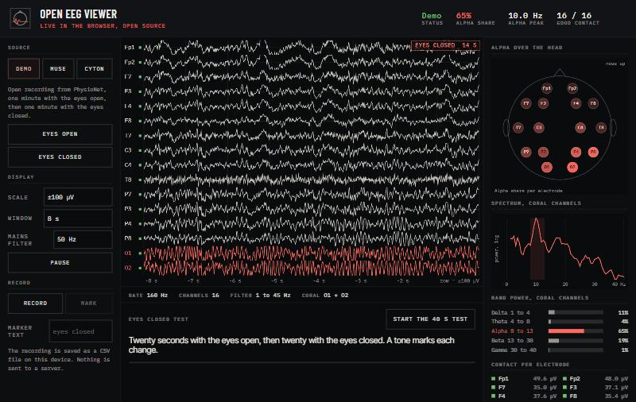](https://theconsciousness.ai/hardware/eeg-viewer/)

## Parameters

All sizes are at the top of `design.py`. Change one, then run `python build.py`. The checks run
each time. `python render.py eeg-headset-frame` makes the CAD renders.

## Changes

| Version | Date | Change |
|---|---|---|
| v0.1.0 | 2026-11-19 | First version. Flat ribs on the 10-20 lines, flanged hubs with engraved names, cable clips, strap tabs with ear-clip lead holes, board pod with a battery bay and a vent cover, carriers for OpenBCI comb electrodes with grip grooves. CAD only. |
