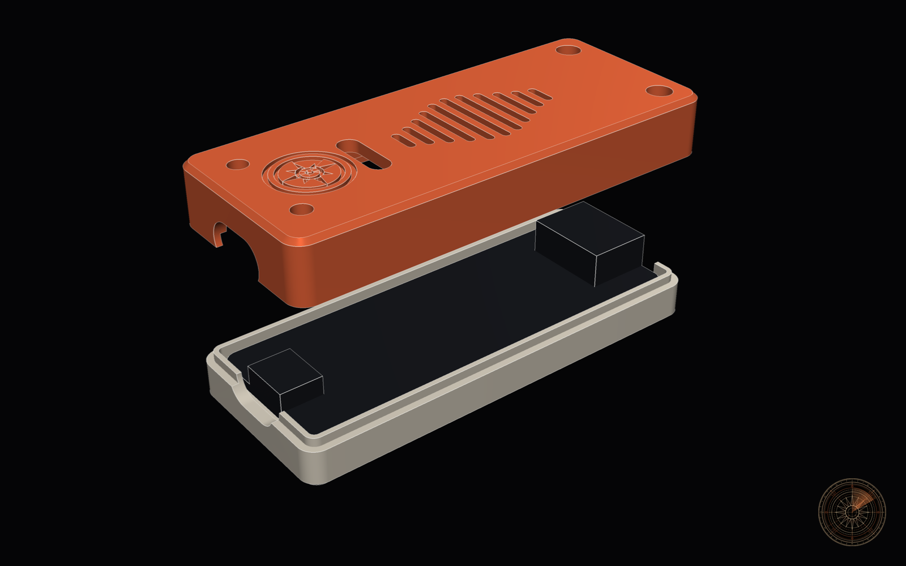
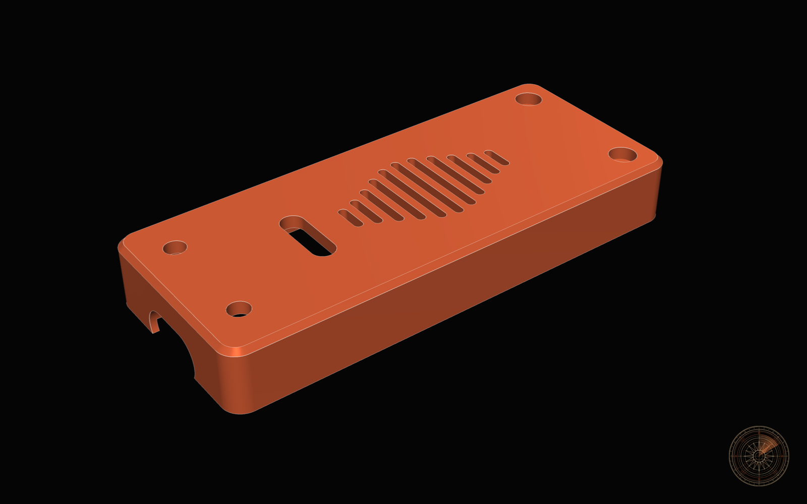
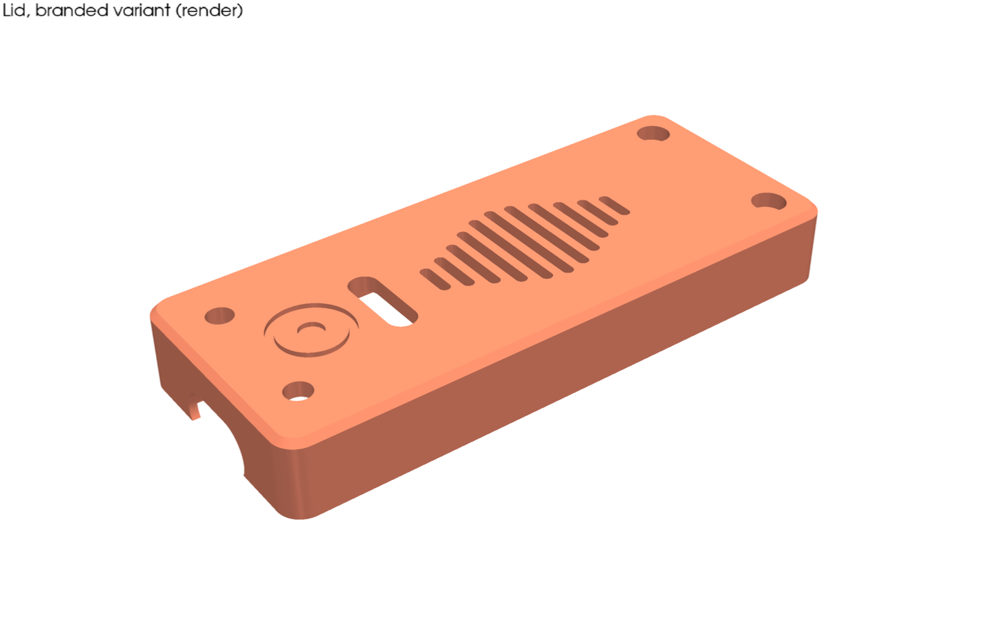
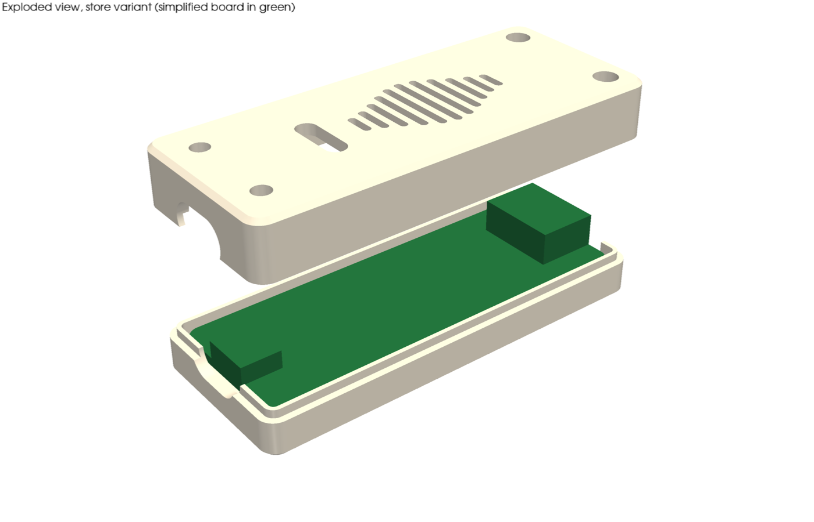
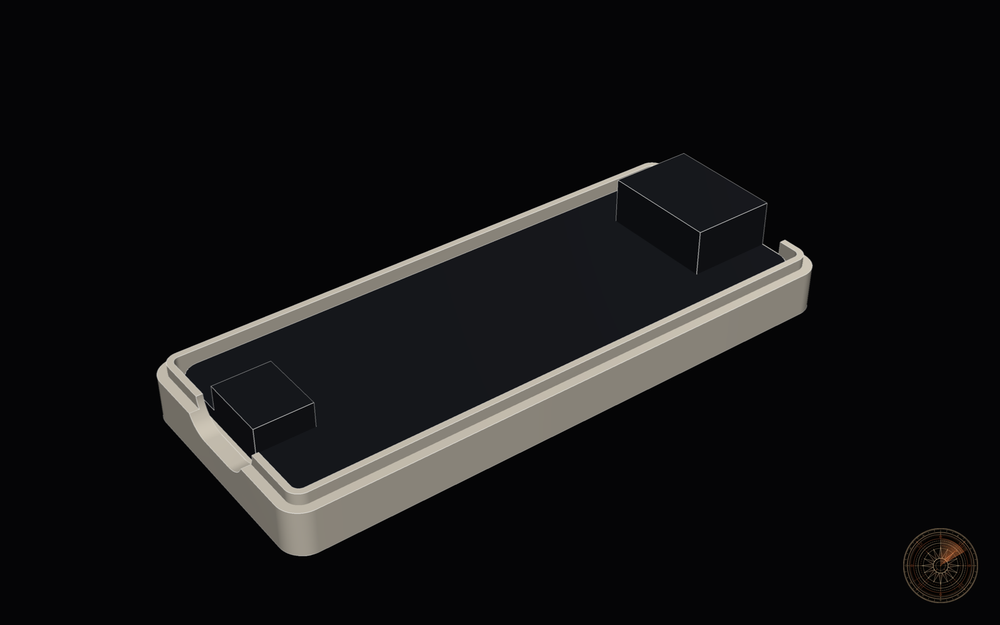
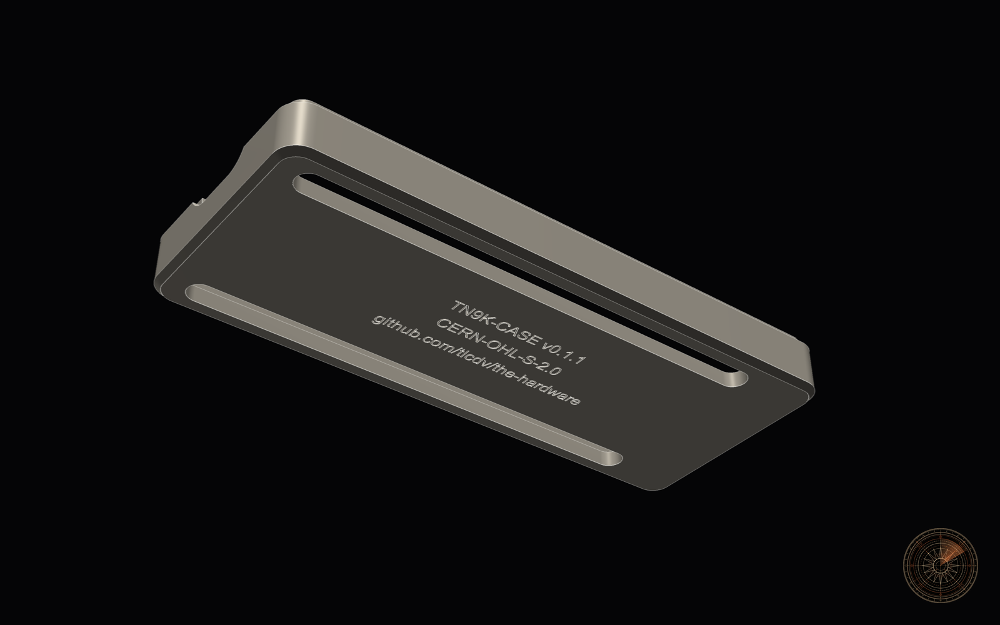
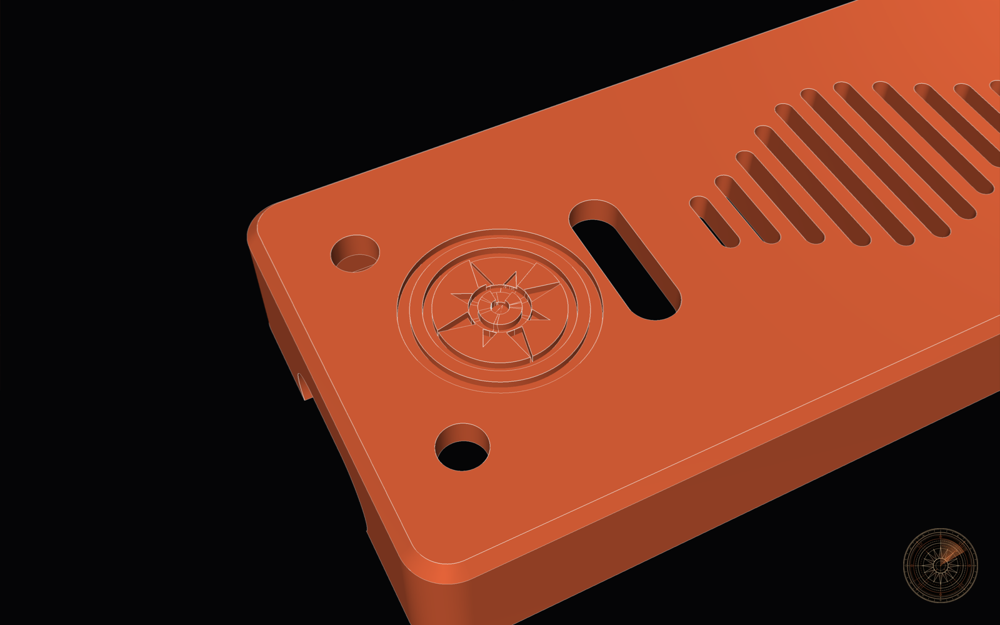

# Tang Nano 9K case (TN9K-CASE) v0.1.1

A two-part case for the Sipeed Tang Nano 9K FPGA board. It is the housing for the
[thermospike](https://github.com/tlcdv/thermospike) FPGA reference design (thermospike plan,
step 3). Any other Tang Nano 9K project can use it too.

## Film

[A box for a computer that runs on noise](https://youtu.be/6x5qe1VAy_4) (1:56, YouTube) shows how the case is built from code, the Boltzmann curve in its vent slots, and the p-bit sampler it is planned for. The shots are renders. The case is not printed yet.

## Images

CAD renders, not photos. The dark block is a simplified board model used for the fit check.

| | |
|---|---|
|  |  |
| Lid, store variant | Lid, branded variant with the compass mark |
|  |  |
| Exploded view, store variant | Base with the simplified board model |
|  |  |
| Base from below, store variant | Base from below, branded variant |
|  | |
| Compass mark on the branded lid, 13 mm, 0.6 mm deep. Personal prints only | |

Copies without the logo, for print service listings, are in [`renders/listing/`](renders/listing/).

## Test state

| Check | State |
|---|---|
| Board outline, holes, header rows | From the Sipeed dimensional drawing (DXF) |
| Fit in CAD (case against a simplified board model) | Passed: 0.000 mm3 overlap, base/lid, base/board, lid/board |
| Component heights (USB-C, HDMI, bottom parts) | **Estimates.** Not in the drawing. |
| Printed | **No** |
| Fit tested with a real board | **No** |
| microSD card access | **Not designed.** The slot position is not in the drawing. |

Do not order a print for a project that depends on it until the "Printed" and "Fit tested" rows
say yes.

## Features

- Base and lid, split at the top face of the PCB. A 0.8 mm lip on the base aligns the lid.
- Two M2 screws (M2 x 14 recommended, M2 x 12 also fits) go through the lid and the two board holes into the base.
- Floor slots for soldered pin headers (2 x 24, 2.54 mm pitch).
- Openings for a USB-C plug and an HDMI plug.
- Poke holes for the S1 and S2 buttons. A window over the six user LEDs.
- Boltzmann vent slots over the FPGA side.
- Outer size 74.8 x 30.8 x 16.6 mm.

## Files

| Part | store variant | branded variant |
|---|---|---|
| Base | `tang-nano-9k-case-base-store` | `tang-nano-9k-case-base-branded` |
| Lid | `tang-nano-9k-case-lid-store` | `tang-nano-9k-case-lid-branded` |

STL and STEP. Build them with `python build.py`, or download them from the release.

## Printing

- Materials: nylon PA12 (MJF or SLS), or PETG on an FDM printer.
- Lid: print with the top face on the bed. Base: print with the floor on the bed.
- Expected: no supports needed. All openings are open notches at the split line. Not tested.

## Parameters

All sizes are at the top of `case.py` (case) and `board.py` (board). Change one, then run
`python build.py`. The fit checks run each time.

## Assembly

1. Put the board on the base. The two board holes go over the two standoffs at the HDMI end.
2. Put the lid on. The posts in the lid sit on the board around the holes.
3. Put in two M2 x 14 screws from the top. Tighten by hand only. The base holes are pilot holes
   for self-tapping into plastic.

## Changes

| Version | Date | Change |
|---|---|---|
| v0.1.1 | 2026-11-17 | The branded base carries the new source address github.com/tlcdv/the-hardware. The engraved lines under the base no longer overlap. In v0.1 the first two lines were cut on top of each other. No change to the shape or the fit. |
| v0.1 | 2026-11-16 | First release. |
