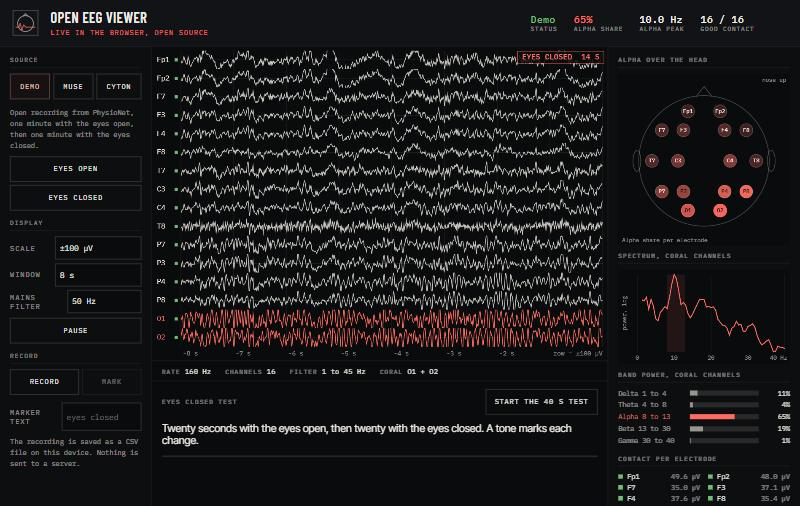

# Open EEG Viewer

Live EEG in the browser for the [EEG headset frame](../../designs/eeg-headset-frame/), a Muse
headband or an OpenBCI Cyton. One JavaScript file, no dependencies, no server. The signal stays
on the device.

Hosted version: https://theconsciousness.ai/hardware/eeg-viewer/



## What it does

- Draws every channel live, filtered from 1 to 45 Hz, with a 50 or 60 Hz mains notch.
- Spectrum, band power (delta, theta, alpha, beta, gamma) and the alpha peak of the channels at the
  back of the head (O1 and O2, or TP9 and TP10 on a Muse).
- A top view of the head with the alpha share of each electrode.
- A contact check per electrode: normal, noisy (above 100 uV RMS), flat or at the end of its range.
- A 40 s eyes closed test that compares the alpha share with the eyes open and closed.
- Records the unfiltered signal, with markers, to a CSV file on the device.
- A demo with open EEG, so it works with no device.
- Two view buttons: hide the side panels, and full screen (on iPhone it fills the window).

## Inputs

| Device | Connection | Browser | Channels |
|---|---|---|---|
| Muse 2, first Muse S | Web Bluetooth | Chrome or Edge on a computer, Chrome on Android | 4 (TP9, AF7, AF8, TP10), 256 Hz |
| OpenBCI Cyton | Web Serial, USB dongle | Chrome or Edge on a computer | 8, 250 Hz |
| OpenBCI Cyton + Daisy | Web Serial, USB dongle | Chrome or Edge on a computer | 16, 125 Hz each |
| Demo | none | any browser | 16, 160 Hz |

iPhone and iPad browsers have no Web Bluetooth and no Web Serial, so only the demo runs there.

Channel order on the frame:

| Input | 1 | 2 | 3 | 4 | 5 | 6 | 7 | 8 |
|---|---|---|---|---|---|---|---|---|
| Cyton | Fp1 | Fp2 | C3 | C4 | P7 | P8 | O1 | O2 |
| Daisy (9 to 16) | F7 | F8 | F3 | F4 | T7 | T8 | P3 | P4 |

## Run it locally

Web Bluetooth and Web Serial need a secure page, and `localhost` counts as one.

```
cd software/eeg-viewer
python -m http.server 8000
```

Then open http://localhost:8000/ in Chrome or Edge.

## Test state

| Check | State |
|---|---|
| Demo with open EEG | Checked. Alpha share at O1 and O2 is 15 % with the eyes open and 63 to 65 % with the eyes closed |
| Muse decoder | Same values as the muse-js test vectors (`muse-parse.spec.ts`, `muse-utils.spec.ts`) |
| Cyton decoder | Same values, to 1e-9 uV, as the official OpenBCI parser (`@openbci/utilities`) on 806 packets, including `samplePacketReal`, a packet recorded from a real board |
| Cyton + Daisy pairing | Same 16 channel frames as the OpenBCI merge (`makeDaisySampleObject`), on a stream cut in random pieces with junk bytes; an unpaired packet is dropped |
| 8 or 16 channels | Read from the reply to the `C` command, as in the Cyton SDK documentation |
| Whole page with simulated devices | A 40 uV sine on the Cyton reads 28.3 uV RMS, a 30 uV sine on the Muse 21.2 uV RMS |
| Real Muse | Not checked yet |
| Real Cyton | Not checked yet |
| Muse S Athena and newer models | Not supported. They may use another protocol |
| Ganglion | Not supported. Use the OpenBCI GUI or BrainFlow |

Not a medical device. For learning and home experiments only.

## Tests

The decoders are checked against the reference data of the two libraries that define the
protocols. 23 checks. Each one fails when the matching part of the decoder is broken on purpose.

```
cd software/eeg-viewer
npm install --no-save @openbci/utilities@1
node test/codec-test.js
```

## Sources

- Muse protocol as implemented in [muse-js](https://github.com/urish/muse-js) by Uri Shaked, MIT.
- Cyton data format: https://docs.openbci.com/Cyton/CytonDataFormat/ and commands: https://docs.openbci.com/Cyton/CytonSDK/
- Reference parser and test data: [OpenBCI_NodeJS_Utilities](https://github.com/OpenBCI/OpenBCI_NodeJS_Utilities) (`@openbci/utilities`, MIT). Daisy pairing as in [OpenBCI_NodeJS_Cyton](https://github.com/OpenBCI/OpenBCI_NodeJS_Cyton).
- Demo data: Schalk et al. (2004), BCI2000, IEEE Trans Biomed Eng 51(6). PhysioNet EEG Motor
  Movement/Imagery Dataset v1.0.0, subject S001, runs 1 and 2, doi 10.13026/C28G6P, ODC-By 1.0.
  `make_demo_data.py` rebuilds `data/` from the two EDF files.

## Licence

The code is MIT, see [LICENSE](LICENSE). The rest of this repository is CERN-OHL-S v2.
